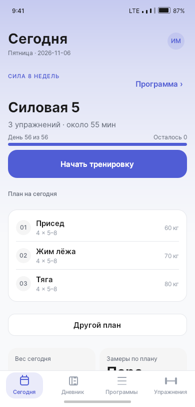
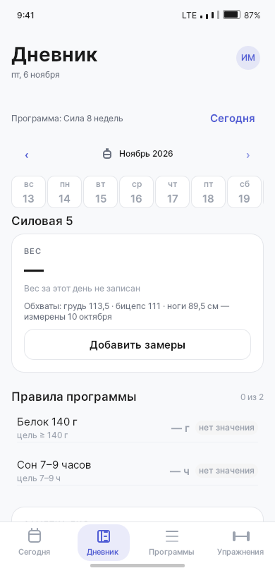
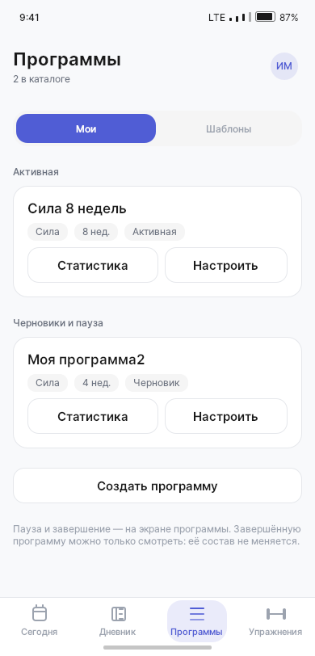
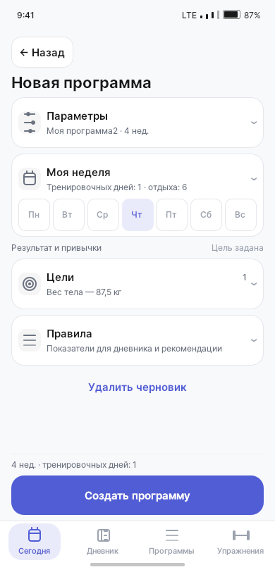
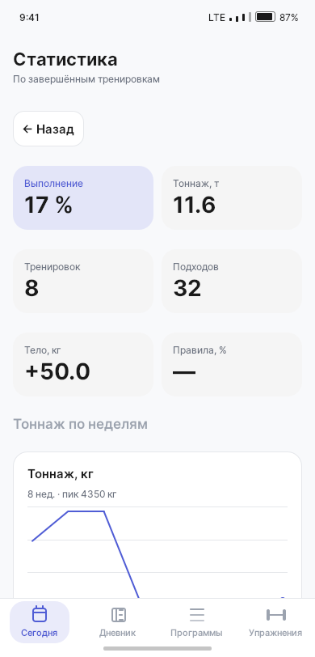
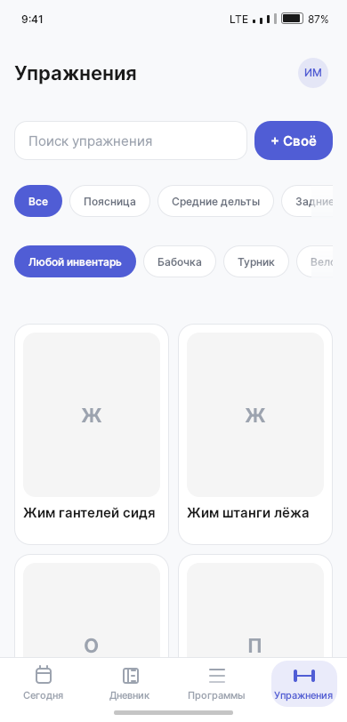

# TrainingAppClient

**«Фитнес-помощник»** — приложение для планирования тренировок, ведения дневника
и отслеживания прогресса. Пользователь составляет программу, задаёт упражнения,
подходы и повторения, отмечает выполнение правил и записывает вес и обхваты.

Целевая платформа — **Android**. Интерфейс написан на **Qt Quick / QML**, модели
и бизнес-логика — на **C++**, локальное хранилище — **SQLite**. Для разработки,
тестов и проверки интерфейса доступна desktop-сборка. Требуется Qt 6.8+;
текущая среда разработки — Qt 6.11.2.

> Проект находится в разработке. Программы, дневник и статистика работают
> с локальными данными; каталог упражнений подключён к API и использует кэш.
> Сквозная запись тренировки с подходами, таймером отдыха и итогами ещё
> не подключена: кнопка старта пока показывает уведомление.

## Возможности

Четыре основных раздела доступны из нижней панели. Профиль и настройки
открываются по аватару в шапке.

| Раздел | Что доступно |
|---|---|
| **Сегодня** | Активная программа, план дня, упражнения и предписанная нагрузка, быстрые отметки правил |
| **Дневник** | Лента дней со свайпом, календарь, вес и обхваты, правила программы, заметка дня и сведения о записанной тренировке |
| **Программы** | Список программ, создание и редактирование, недельное расписание, упражнения, цели и правила, управление активной программой |
| **Упражнения** | Разделы «Все», «Мои», «Сообщество»; поиск, панель фильтров мышц и инвентаря с поиском и множественным выбором; карточки и свои упражнения |

Дополнительно:

- Дневник доступен и без активной программы: личные записи сохраняются отдельно
  от правил конкретной программы.
- Вес и обхваты вводятся в общей форме с единицами измерения и проверкой значений;
  состав целевых замеров определяется программой.
- В программе доступны статистика выполнения, тоннаж, динамика веса и обхватов.
- Есть калькулятор КБЖУ, светлая и тёмная темы, выбор акцентного цвета.
- Локальные программы, замеры и заметки сохраняются в SQLite между запусками.
  Каталог упражнений поддерживает чтение из кэша при отсутствии сети.

**Ещё в работе:** полноценная запись тренировки и восстановление её черновика,
история силы и рекордов упражнения, сравнение программ, копирование шаблонов,
редактирование профиля и завершение сценариев синхронизации. Наличие кнопки или
HTML-макета само по себе не означает готовность функции в Qt.

## Интерфейс

Снимки интерфейса за **6–8 ноября 2026**, светлая тема, область интерфейса
390 × 812. Это desktop-снимки в телефонном режиме с локальными данными,
а не HTML-макет и не снимки Android. Изображения упражнений зависят от доступных
данных и кэша: при отсутствии фото показан плейсхолдер.

| Сегодня | Дневник | Программы |
|:---:|:---:|:---:|
|  |  |  |

| Создание программы | Статистика | Каталог упражнений |
|:---:|:---:|:---:|
|  |  |  |

## Сборка и запуск

Нужны CMake, компилятор из выбранного Qt kit и модули Qt Quick, Quick Controls 2,
Quick Layouts, Quick Effects, Network и Sql. Для тестов — Qt Test и QuickTest.

### Desktop

Откройте `CMakeLists.txt` в Qt Creator и выберите desktop-kit, например
**Desktop Qt 6.11.2 MinGW 64-bit**. Цель приложения — `appTrainingAppClient`.

Пример сборки из терминала с доступными в `PATH` CMake, Ninja и компилятором:

```powershell
cmake -S . -B build/desktop -G Ninja -DCMAKE_PREFIX_PATH=D:/Qt/6.11.2/mingw_64
cmake --build build/desktop --target appTrainingAppClient
.\build\desktop\appTrainingAppClient.exe
```

Для запуска DLL Qt должны быть доступны в `PATH` либо развёрнуты рядом
с исполняемым файлом через `windeployqt`.

Обычный запуск позволяет пользоваться локальными разделами без обязательного
входа. В Release-сборках реальная авторизация включена автоматически через
C++-мост `AuthBackend` (также в RelWithDebInfo и MinSizeRel). В Debug UI авторизации
использует presentation-mock; флаг `--real-auth` подключает настоящий backend.
Базовый адрес API можно задать флагом `--api-url <url>`.

### Android

Откройте проект в Qt Creator, выберите Android-kit и устройство или эмулятор.
Для сборки требуются Android SDK Platform 36 и Build Tools 36.0.0:
проект задаёт `compileSdk = 36` для AndroidX Core из Qt 6.11.2. Если в шаге
сборки APK явно выбран Android SDK 34, выберите 36: параметр
`androiddeployqt --android-platform` имеет приоритет над настройкой CMake.
В текущей среде используется **Qt 6.11.2 for Android x86_64**. Приложение работает
в портретной ориентации и учитывает системные безопасные области.

Инструкции по SDK, сборке, установке и проверке на устройстве:
[Android](docs/android/README.md).

### Проверка интерфейса и скриншоты

| Аргумент | Назначение |
|---|---|
| `--frame` | Телефонный режим 390 × 812 |
| `--tab <0..3>` | Сегодня / Дневник / Программы / Упражнения соответственно |
| `--screen <имя>` | Прямой переход, например `diary`, `program-edit`, `program-stats`, `exercise-detail`, `profile`, `auth-login` |
| `--authenticated` | Демо-сессия для проверки UI; не вход на сервер |
| `--unauth` | Принудительно гостевой режим |
| `--real-auth` | Подключение реального auth API |
| `--api-url <url>` | Переопределение базового адреса API |
| `--dark` / `--light` | Принудительный выбор темы |
| `--accent <0..3>` | Выбор акцентного цвета |
| `--width <px>` / `--height <px>` | Размер обычного desktop-окна |
| `--screenshot <путь.png>` | Снимок в телефонном режиме и выход |
| `--diag` | Проверка геометрии интерфейса с выводом в stderr и выход |

Пример из каталога сборки:

```powershell
.\appTrainingAppClient.exe --authenticated --tab 0 --screenshot today.png
.\appTrainingAppClient.exe --authenticated --tab 1 --screenshot diary.png
.\appTrainingAppClient.exe --authenticated --tab 2 --screenshot programs.png
.\appTrainingAppClient.exe --authenticated --tab 3 --screenshot exercises.png
```

Снимки используют текущее локальное хранилище. `--authenticated` не наполняет
его программами. Отдельный флаг `--demo-seed` записывает демонстрационные данные
в SQLite и предназначен для тестового окружения.

## Тесты

C++- и QML-тесты, проверки геометрии и UI smoke-сценарии зарегистрированы в CTest:

```powershell
ctest --test-dir build/desktop --output-on-failure
```

Проверка включает форматирование, конфигурацию, `qmllint`, сборку и тесты.

Для C++ нужна версия `clang-format` из корневого `.clang-format-version`.
Установить её и применить форматирование можно из `TrainingAppClient`:

```powershell
$formatVersion = (Get-Content ../.clang-format-version -Raw).Trim()
python -m pip install "clang-format==$formatVersion"
.\scripts\format-cpp.ps1
.\scripts\format-cpp.ps1 -Check
```

Полная проверка:

```powershell
.\scripts\run-gates.ps1 -BuildDir build/ci -Generator Ninja -QtPrefix D:\Qt\6.11.2\mingw_64
```

Последняя проверка редизайна, 6 ноября 2026: сборка приложения и **134/134 CTest**.
Покрытие включает репозитории и модели, сохранение дневника, календарь,
редактирование программ, навигацию и адаптивность интерфейса. Это не заменяет
ручную проверку Android-клавиатуры, жестов и производительности на устройстве.
Подробности: [тесты](tests/README.md).

## Структура проекта

```text
qml/Main.qml          окно, темы, аргументы запуска, снимки и аудит
qml/AppShell.qml      вкладки, навигация и стек экранов
qml/Pages/            экраны приложения
qml/Components/       общие элементы управления
qml/Theme/            цвета, типографика Inter и отступы
qml/Mock/             демонстрационная сессия и mock API для UI/тестов
src/App/              composition root и конфигурация
src/Domain/           сущности, контракты и бизнес-правила
src/Data/             HTTP, SQLite и репозитории
src/Presentation/     C++ ViewModel и модели списков для QML
src/Platform/         интеграция с платформой
android/              Android-манифест и ресурсы
resources/            шрифты и ресурсы приложения
tests/                C++, QML и UI smoke-тесты
scripts/              проверки и установка Git hooks
docs/                 архитектура, планы и скриншоты
```

Данные desktop-сборки находятся в
`%APPDATA%/FitnessAssistant/TrainingAppClient/`, база — `training-app.sqlite3`,
логи — `logs/app.log`. Логгер использует категории `trainingapp.*` и ротацию
по размеру. Пароли, токены и тела HTTP-запросов в логи не записываются.

## Документация

| Документ | Содержание |
|---|---|
| [Архитектура](docs/01-architecture.md) | Слои и конфигурация клиента |
| [Модель программы](docs/02-program-model.md) | Цели, расписание, правила и статистика |
| [Контракт API](docs/03-api-contract.md) | Auth, users, exercises и открытые вопросы |
| [Дорожная карта](docs/04-roadmap.md) | Этапы реализации |
| [План переделки UI](docs/14-ui-rework-plan.md) | Новая навигация и этапы редизайна |
| [Дневник и календарь](docs/15-diary-calendar-review.md) | Последние изменения и остаток работ |
| [Android](docs/android/README.md) | Сборка, развёртывание и мобильный чек-лист |
| [Стиль кода](docs/CODE_STYLE.md) | Правила C++ и QML |
